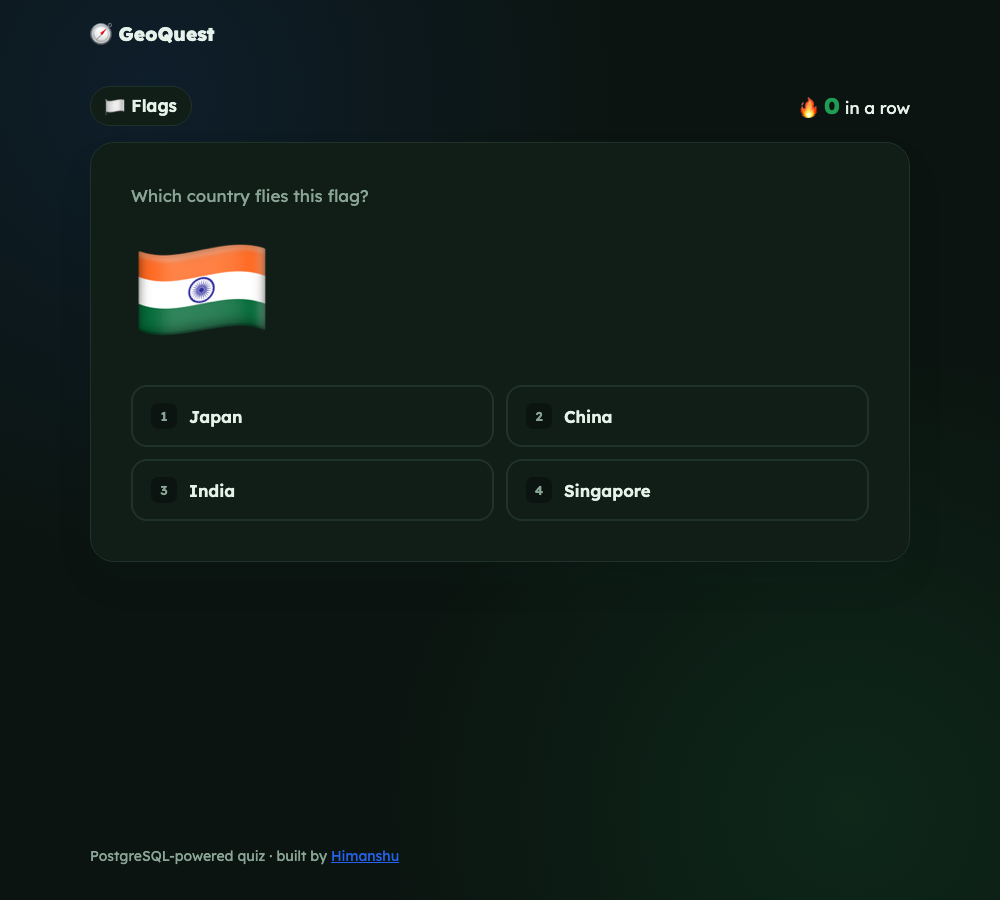

# 🧭 GeoQuest

> A capitals and flags quiz backed by **PostgreSQL**. Keep a streak alive, then post your score to the leaderboard. Game state is **HMAC-signed**, so the server stays stateless and streaks can't be faked.

[](https://github.com/himanshuuem/geoquest/actions/workflows/test.yml)




## ✨ Features

- **Two modes:** 🏛️ *Capitals* (name the capital) and 🏳️ *Flags* (which country's flag is this?). Flags are generated from ISO codes as emoji, so there are no image files.
- **Multiple choice done in SQL:** one random country plus three distractors, **preferring the same continent** (`ORDER BY (continent = $2) DESC, random()`), so Kenya's distractors are other African capitals rather than giveaways.
- **No repeats:** recently asked countries are excluded with `NOT (id = ANY($1::int[]))`.
- **Tamper-proof, stateless game state:** the streak, current question and recent history travel in a signed token. Editing it in DevTools invalidates it, and the tests check this. The course version kept this in a global variable, which every player would share.
- **Leaderboard** with `CHECK` constraints, an index on `(mode, streak DESC, created_at)` and medals for the top three.
- **Keyboard play:** press <kbd>1</kbd>–<kbd>4</kbd> to answer.
- Parameterised queries everywhere (no SQL injection), a connection pool and graceful shutdown that drains it.

## 🗄️ Schema

```sql
countries (id SERIAL PK, code CHAR(2) UNIQUE, name UNIQUE, capital, continent)
scores    (id SERIAL PK, nickname CHECK 2–20 chars, mode CHECK IN ('capitals','flags'),
           streak CHECK >= 0, created_at TIMESTAMPTZ DEFAULT now())
```

## 🚀 Run Locally

You need Node 20+ and PostgreSQL (local, Docker, or a free [Neon](https://neon.tech) / [Render](https://render.com) database).

```bash
git clone https://github.com/himanshuuem/geoquest.git
cd geoquest
npm install
cp .env.example .env          # set DATABASE_URL
createdb geoquest             # or: docker run -e POSTGRES_PASSWORD=postgres -p 5432:5432 postgres:16
npm run db:setup              # creates tables + seeds 75 countries
npm run dev                   # http://localhost:3000
```

### Tests

```bash
npm test                                   # unit tests (DB tests skip without DATABASE_URL)
DATABASE_URL=postgres://... npm test       # full suite against a real database
```

CI runs the full suite against a `postgres:16` service container.

## ☁️ Deploy (free)

`render.yaml` provisions a free Postgres database and web service, runs `db:setup` on build and generates `SESSION_SECRET`.

> Flag emoji render on macOS, iOS, Android and Linux. Windows shows letter pairs instead.

## 📚 Origin

This combines the **World Capitals Quiz** and **Flag Quiz** from the PostgreSQL section of [The Complete Web Development Bootcamp](https://www.udemy.com/course/the-complete-web-development-bootcamp/) into one app with smarter distractors, signed state and a leaderboard.

---

Made by [Himanshu](https://github.com/himanshuuem)
